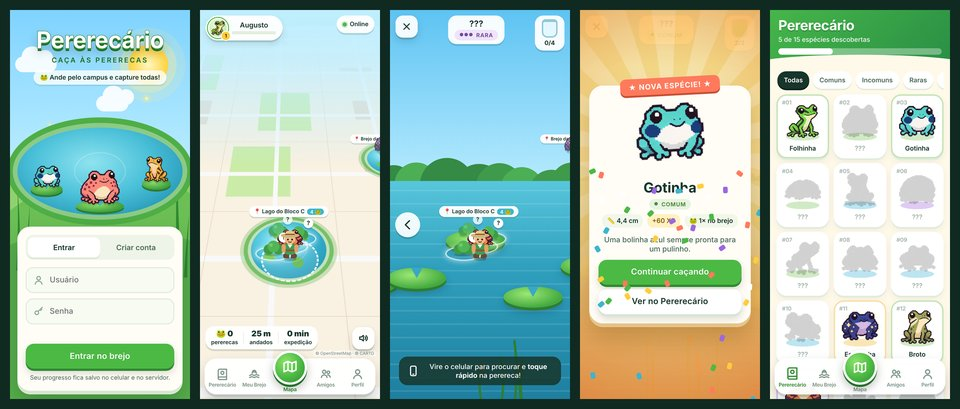

# Pererecário 🐸

Jogo para celular no estilo "anda e captura": as pererecas ficam esperando nos **brejos do campus**, você caminha até elas com o GPS e **toca rápido** para capturá-las. O jogo funciona **online e offline**: tudo fica salvo no aparelho e é sincronizado com o servidor quando a conexão volta.

Trabalho prático de **Sistemas Distribuídos / Computação Móvel e Ubíqua**.



- **Documentação completa do trabalho:** [`docs/RELATORIO.md`](docs/RELATORIO.md) (armazenamento local, sincronização, conflitos, falhas, computação ubíqua)
- **Roteiro da apresentação (testes obrigatórios):** [`docs/ROTEIRO_APRESENTACAO.md`](docs/ROTEIRO_APRESENTACAO.md)
- **Artes (o que trocar e em que formato):** [`docs/ARTES.md`](docs/ARTES.md)

## Como jogar

1. Abra o link do jogo no celular (Chrome no Android ou Safari no iPhone), crie a conta e permita **localização** e **sensores de movimento**.
2. Na primeira vez, um tutorial curto explica o jogo e você escolhe o seu explorador.
3. Ande até uma **lagoinha** do campus. As pererecas comuns ficam à vista, pulando em volta dela; as mais raras se escondem nos **matinhos com "?"**.
4. Chegou a 20 m de um matinho? **Toque nele** ou **chacoalhe o celular** (revela todos por perto) para a perereca sair.
5. A até **10 m**, toque na perereca para escolhê-la. Na captura, **toque rápido** nela várias vezes, enquanto ela pula entre as vitórias-régias, até encher o pote.
6. Encontrou outro jogador? Na aba **Amigos**, um escaneia o **QR code** do outro: vocês viram parceiros de brejo e quem escaneou ganha uma **perereca-presente** (uma por amigo por dia).
7. Complete o **Pererecário** (15 espécies, das comuns até a especial) e veja suas repetidas no **Meu Brejo**. Cada dia em que você joga é uma **caçada**; no Perfil ficam a caçada de hoje, o ranking e o **Diário de campo** com as últimas capturas.

Para instalar como app: no Android, menu ⋮ → "Instalar app"/"Adicionar à tela inicial"; no iPhone, Compartilhar → "Adicionar à Tela de Início".

## Rodar localmente

Requer apenas **Node.js 22.13+** (o servidor não tem dependências para rodar com SQLite).

```bash
npm start            # http://localhost:8080  (usa SQLite em data/pererecario.db)
npm test             # 14 testes de sincronização, idempotência, conflitos e falhas
```

Painel do servidor: `http://localhost:8080/admin` (chave padrão local: `brejo-admin`; em produção, defina `ADMIN_KEY`).

> No celular, GPS, câmera e sensores só funcionam com **HTTPS**. Para testar no aparelho use o deploy abaixo (ou um túnel HTTPS para o seu computador).

## Colocar no ar (Render, grátis)

1. Crie uma conta em [render.com](https://render.com) (pode entrar com o GitHub).
2. **New → Blueprint** e escolha este repositório. O arquivo [`render.yaml`](render.yaml) cria o servidor Node e um banco **PostgreSQL gratuito**.
3. Quando pedir `ADMIN_KEY`, invente uma senha (é a do painel `/admin`). `CARTO_KEY` é opcional: deixe vazio para usar o mapa padrão do OpenStreetMap, ou cole a chave gratuita do CARTO para um mapa mais limpo.
4. Aguarde o deploy e abra a URL `https://pererecario-xxxx.onrender.com`. Esse é o link para os jogadores (gere um QR code dele para o público).

Observações do plano gratuito do Render: o servidor "dorme" após 15 min sem acesso e leva ~1 min para acordar (o jogo continua funcionando offline nesse meio-tempo e sincroniza depois); o Postgres gratuito expira 30 dias após criado. Por isso o banco é Postgres e não SQLite: no plano grátis, arquivos locais são apagados quando o servidor dorme.

## Cadastrar os brejos do campus

Os brejos são áreas circulares (centro + raio) guardadas no servidor. Duas formas:

- **No local, pelo celular:** Perfil → Painel de demonstração → informe a chave de administrador → "Criar brejo onde estou".
- **Pelo computador:** abra `/admin`, cole as coordenadas copiadas do Google Maps ("-23.1093, -50.3591"), dê um nome e um raio (25–60 m funciona bem).

Cada brejo vira uma lagoinha no mapa, com 3 a 7 pererecas em volta (depende do raio), que mudam a cada **15 minutos**. Um raio de 30 a 40 m funciona bem. Dois brejos não podem ficar em cima nem colados um no outro (o servidor recusa).

## Estrutura

```
client/                 PWA (HTML/CSS/JS sem build)
  index.html, sw.js     app shell + Service Worker (offline)
  js/shared/game.js     regras determinísticas compartilhadas com o servidor
  js/db.js              IndexedDB (armazenamento local persistente)
  js/store.js           estado = último estado do servidor + fila de operações
  js/sync.js            módulo de sincronização (conectividade, reenvio, backoff)
  js/geo.js, sensors.js GPS (real ou simulado) e acelerômetro (chacoalhar)
  js/ui/                telas: login, mapa, captura, álbum, Meu Brejo, amigos, perfil, demonstração
  admin.html            painel do servidor (dados, conflitos, simulação de queda)
  assets/               atlas com as 15 pererecas + catálogo das espécies
server/                 Node.js (http nativo) + SQLite/PostgreSQL
  app.js                rotas REST
  sync.js               aplicação idempotente das operações e resolução de conflitos
  db.js                 camada de banco (mesmo SQL nos dois motores)
test/sync.test.js       testes automatizados
```

## Autor

**Danilo Augusto Salvego dos Santos** · GitHub: [AugustoSalvego](https://github.com/AugustoSalvego)

Mapa: © colaboradores do OpenStreetMap (ou CARTO Voyager, se o servidor tiver a variável `CARTO_KEY` com a chave gratuita de carto.com/basemaps/apikey). Bibliotecas incluídas: [qrcode-generator](https://github.com/kazuhikoarase/qrcode-generator) (MIT) e [jsQR](https://github.com/cozmo/jsQR) (Apache-2.0).
