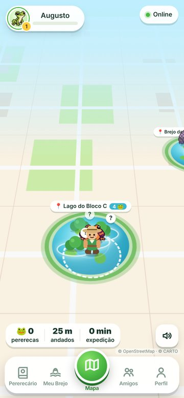
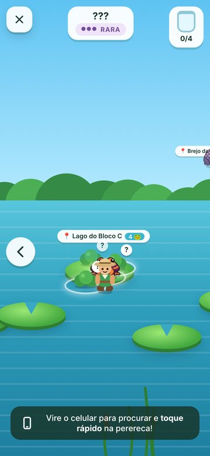
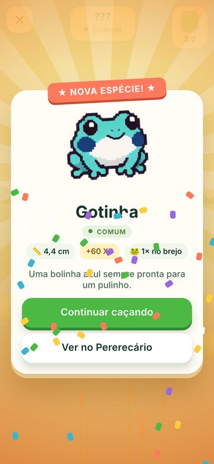
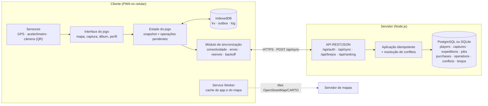
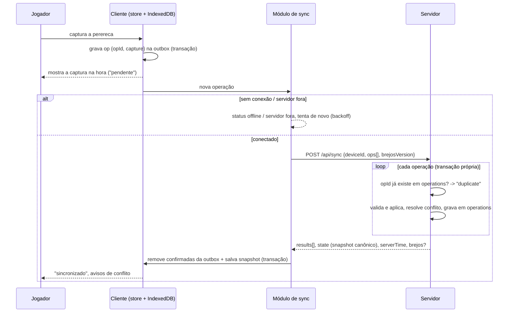
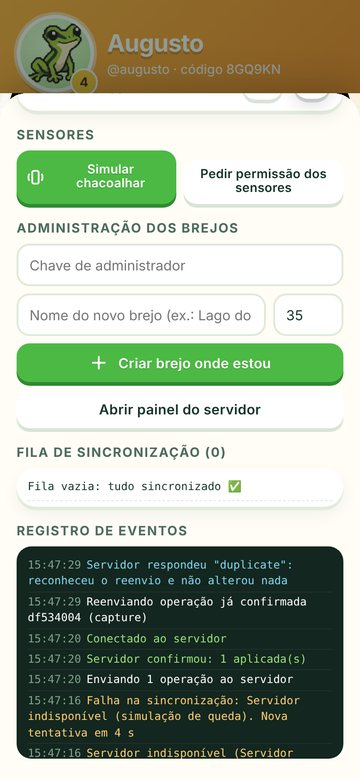

# Pererecário: documentação do trabalho

Trabalho prático de Sistemas Distribuídos: jogo para computação móvel com funcionamento online e offline.

## 1. Descrição do jogo

O Pererecário é um jogo de localização no estilo "anda e captura". Os **brejos** são áreas circulares sobre o mapa real, desenhadas como **lagoinhas**. Elas aparecem **em qualquer lugar**, sem cadastro (uma a cada ~130 m), como no Pokémon GO; os organizadores também podem cadastrar brejos à mão em pontos específicos. Em volta de cada lagoinha vivem de 3 a 7 pererecas (4 nas automáticas), que mudam a cada 15 minutos. As **comuns** ficam à vista no mapa, dando pulinhos; as **incomuns, raras e a especial** se escondem num **matinho** (que mostra um "?" de tempos em tempos): o jogador caminha até lá (GPS) e, a até 20 m, **toca no matinho** ou **chacoalha o celular**; o matinho espia por 1 s e a perereca sai. Depois, a até **10 m**, toca nela no mapa para escolhê-la e entra no minijogo de captura: a perereca pula entre as vitórias-régias da tela e o jogador **toca rápido** nela até pegar: no mínimo 3 toques, mais nas raras, sem mostrar quantos faltam.

**Como as lagoinhas e as pererecas aparecem.** Não existe um "sorteio" no servidor que precise ser enviado aos celulares. O mundo é coberto por uma grade fixa de ~130 m; para cada ponto da grade, um gerador pseudoaleatório determinístico (semente = **o jogador** + o ponto da grade) decide se ali existe uma lagoinha, onde exatamente ela fica e o nome dela. Da mesma forma, as pererecas de cada lagoinha saem de um gerador alimentado pelo jogador, pelo id da lagoinha e pela janela de 15 minutos. Por isso **cada jogador tem as suas lagoinhas e as suas pererecas**: dois jogadores lado a lado veem lagoinhas diferentes, e um não "rouba" a perereca do outro. Os dois aparelhos de um mesmo jogador, porém, veem exatamente as mesmas (é isso que permite o teste de conflito). Assim, o celular offline e o servidor chegam exatamente às mesmas pererecas, e o servidor consegue conferir qualquer captura recebida depois: a partir do id da lagoinha ele recalcula onde ela fica, sem precisar de nada guardado no banco. As pererecas nascem afastadas da lagoinha e umas das outras. No mapa, só aparecem as pererecas a até 90 m do jogador e as lagoinhas a até 400 m; quando não há nada por perto, uma seta indica a lagoinha mais próxima. Todos esses números ficam num único bloco de balanceamento (`client/js/shared/game.js`, explicado em `docs/BALANCEAMENTO.md`).

Existem 15 espécies em 4 raridades (comum 55 %, incomum 28 %, rara 13 %, especial 4 %). Cada jogador escolhe o seu boneco entre **18 estilos** (do Capuz de Sapo ao Ninja, Samurai, Cavaleiro, Mágica e Piloto de Robô), em versão masculina ou feminina e 3 tons de pele; ele anda no mapa nas 4 direções.

**Dois modos de andar.** No **modo GPS** o boneco segue o celular e aparecem todas as pererecas. No **modo controle** o jogador anda com um joystick na tela (ou com as setas do teclado), sem sair do lugar, mas só aparece uma parte das raras (80 % das incomuns, 35 % das raras e 15 % das especiais). Quem anda de verdade é recompensado. Cada captura leva o modo em que foi feita, e o servidor recusa uma perereca "só de GPS" capturada no modo controle.

**Jogadores juntos no mapa.** Quem está com o jogo aberto a até 300 m aparece no mapa dos outros, com o boneco e o nome. Se várias pessoas estão no mesmo lugar (por exemplo, numa sala, onde o GPS de todos dá praticamente o mesmo ponto), os bonecos são afastados automaticamente até uma distância mínima na tela, sempre do mesmo jeito, então o mapa fica estável. Quem não quiser aparecer desliga isso no Perfil.

**Dia e noite.** O jogo calcula a altura do sol no lugar e na hora em que o jogador está. De dia o mapa fica nas cores normais; à noite (sol abaixo de 4° do horizonte) fica azulado, com uma luz em volta do boneco e vaga-lumes, e o minijogo de captura mostra lua e estrelas.

Jogadores que se encontram pessoalmente podem escanear o **QR code** um do outro: viram "parceiros de brejo" e quem escaneou ganha uma perereca-presente.

**Trabalhos e Brejais.** Pelo mapa aparecem moradores (NPCs) pedindo ajuda, com um balãozinho que mostra o serviço: o **pedreiro** constrói uma casinha, a **mecânica** conserta um carro, o **agricultor** cuida da horta e o **carteiro** pede uma entrega. Eles aparecem em qualquer lugar e mudam a cada 15 minutos, pelo mesmo sorteio determinístico das lagoinhas (grade de ~180 m, semente = jogador + janela + ponto da grade), então o celular offline e o servidor chegam aos mesmos moradores. Cada trabalho é um minijogo de 3 etapas, só de tocar, em que cada toque muda um pedaço da cena de vez: a parede sobe tijolo por tijolo, o telhado fecha, a tinta cobre a casa; as porcas saem da roda, a fumaça do motor diminui a cada parafuso, o barro sai do carro; o mato é arrancado, a terra fica molhada e os tomates vão para o cesto. Cada trabalho leva no máximo 5 minutos; a entrega é diferente: o jogador leva a caixa até uma lagoinha a 140–260 m, com 5 minutos de prazo. No fim aparece só o agradecimento ("O pedreiro agradece!") e o botão **Coletar B$ X**. A moeda do jogo são os **Brejais (B$)**; quem faz o trabalho no modo GPS ganha 50 % a mais.

**Pererecas soltas no mato.** Além das lagoinhas, uma segunda grade invisível (~70 m) espalha "moitinhas" com 1 ou 2 pererecas soltas na grama, longe da água. Elas usam o mesmo sorteio determinístico e o mesmo formato de id de encontro (`m<i>_<j>:<janela>:<n>`), então o servidor valida a captura delas do mesmo jeito que a de uma lagoinha.

**Meu Brejo como bolsa.** As pererecas capturadas podem ser vendidas por Brejais: o preço depende da raridade e do tamanho (a maior da espécie vale até 50 % a mais). Dá para vender uma de cada vez ou todas as repetidas de uma vez (fica a maior de cada espécie). Favoritas ficam guardadas e não são vendidas. Vender não apaga a espécie do Pererecário nem o XP.

**Ranking.** Três quadros: mais XP, mais capturas e mais Brejais ganhos (trabalhos + vendas; comprar carro não tira pontos). No perfil aparecem os 5 primeiros de XP com medalhas de ouro, prata e bronze; "Ver todos" abre o pódio e as três abas.

**Loja e carros.** Com os Brejais o jogador compra um carro na **Loja do Brejo**: Hatch (B$ 150), Sedã (250), Picape (400), Jipe (600, revela os matinhos de mais longe) e Superesportivo (1500). O carro deixa o joystick mais rápido (de 3,5 m/s a pé até 12 m/s) e **só anda no modo Controle**: no GPS o jogador sempre está a pé. Os carros têm o tamanho do boneco, nas 4 direções, e quem está perto vê o carro com um balãozinho do rosto e do nome de quem está dirigindo.

| Requisito do enunciado | No jogo |
|---|---|
| Identificação do jogador | Conta com usuário e senha; token assinado guardado no aparelho |
| Estado e progresso das partidas | **Caçada do dia** = a partida: criada automaticamente no primeiro movimento ou captura do dia; acumula capturas, XP e distância. O identificador é fixo por jogador e por dia (`dia:<jogador>:<dia>`), então dois aparelhos no mesmo dia jogam **a mesma partida** |
| Pontuações e resultados | XP por captura (10/25/60/150 + 50 por espécie nova), nível, ranking geral, saldo de Brejais |
| Histórico das partidas | No servidor, cada partida fica registrada com jogador, dia, pererecas, distância e quantos aparelhos jogaram nela (visível no painel `/admin`). No app, o **Diário de campo** mostra as últimas capturas e o Perfil mostra a caçada de hoje |

| Tela | |
|---|---|
|  |  |
|  |  |

## 2. Arquitetura

Os três componentes pedidos no enunciado:

- **Cliente** (`client/`): executa o jogo, conversa com o jogador e guarda tudo localmente (IndexedDB + Service Worker). É uma PWA: roda no navegador do celular, instala na tela inicial e abre em tela cheia.
- **Servidor** (`server/`): recebe, valida, armazena e disponibiliza os dados sincronizados. Node.js com o módulo `http` nativo; banco PostgreSQL em produção e SQLite local, com o mesmo SQL.
- **Sincronização** (`client/js/sync.js` + `server/sync.js`): fila de operações no cliente, protocolo de envio em lote, idempotência, reconciliação de estado, tratamento de falhas e de conflitos.

Uma decisão importante é que **as regras do jogo são determinísticas e compartilhadas** (`client/js/shared/game.js`, importado pelo navegador e pelo servidor). As pererecas de cada brejo são calculadas a partir de `hash(idDoBrejo | janelaDe15min)`, com um gerador pseudoaleatório. Cliente e servidor chegam exatamente às mesmas pererecas **sem trocar mensagens**. Por isso o jogo offline não depende do servidor para nada essencial, e o servidor consegue validar qualquer captura recebida depois, recalculando o encontro.

## 3. Tecnologias e protocolos

| Camada | Tecnologia |
|---|---|
| Cliente | HTML, CSS e JavaScript (módulos ES, sem etapa de build), PWA (Web App Manifest + Service Worker) |
| Armazenamento local | IndexedDB (persistente; `navigator.storage.persist()` pede ao navegador para não apagar) |
| Cache offline | Cache Storage via Service Worker |
| Mapa | Renderizador próprio, visto de cima, sobre tiles raster do OpenStreetMap (padrão, sem chave) ou do CARTO Voyager (com a chave gratuita em `CARTO_KEY`). Os tiles vistos ficam em cache para o modo offline; com CARTO, os arredores das lagoinhas são baixados antes |
| Sensores | Geolocation API (`watchPosition`), DeviceMotion (acelerômetro), getUserMedia + BarcodeDetector/jsQR (QR code), Vibration API, Web Audio |
| Servidor | Node.js 22, módulo `http`, `node:sqlite` (local) ou `pg` (PostgreSQL) |
| Protocolo | HTTPS com REST/JSON. Autenticação por token assinado com HMAC-SHA256 (cabeçalho `Authorization: Bearer`) |
| Senhas | scrypt com sal aleatório |
| Hospedagem | Servidor no Render (`render.yaml`) e PostgreSQL no Neon (gratuito, sem prazo de validade); backup do banco inteiro a cada 6 h pelo GitHub Actions, criptografado (`docs/HOSPEDAGEM.md`) |

Rotas principais:

| Rota | Função |
|---|---|
| `POST /api/auth/register`, `POST /api/auth/login` | Cria conta / entra; devolve token, jogador e hora do servidor |
| `POST /api/sync` | Envia até 100 operações e recebe o resultado de cada uma, o estado canônico do jogador e os brejos (se mudaram) |
| `GET /api/brejos` | Lista de brejos e a versão da lista |
| `GET /api/ranking` | Ranking geral |
| `POST /api/presence` | Informa a posição atual e recebe os jogadores por perto (a até 300 m) |
| `GET /api/players/code?code=` | Busca jogador pelo código de amigo |
| `GET /api/health`, `/healthz` | Verificação de disponibilidade |
| `/api/admin/*` | Painel do servidor, cadastro de brejos e simulação de queda (exige `X-Admin-Key`) |

## 4. Estratégia de armazenamento local

O IndexedDB tem três "tabelas" (`client/js/db.js`):

- **`kv`**: sessão (token e jogador), `snapshot` (último estado confirmado pelo servidor), brejos e versão, diferença de relógio com o servidor, configurações, pererecas reveladas, distância percorrida na caçada do dia, e o identificador do aparelho (`deviceId`).
- **`outbox`**: a **fila de operações** ainda não confirmadas, em ordem (chave autoincremental). Cada operação tem `opId` (UUID gerado no aparelho), tipo, dados, horário e número de tentativas.
- **`log`**: os últimos 150 eventos de sincronização, exibidos no painel de demonstração.

**O que o jogador vê = snapshot do servidor + operações pendentes reaplicadas por cima** (`store.recompute()`). Assim:

- uma captura offline aparece na hora no Pererecário e no Meu Brejo, marcada como "pendente";
- quando o servidor confirma, a operação sai da fila e o snapshot novo já contém a captura, sem "piscar" nem duplicar;
- se o servidor decidir diferente (conflito), o snapshot canônico prevalece automaticamente.

**Atomicidade local:** a captura é gravada com uma única transação do IndexedDB que escreve a operação na fila e atualiza a atividade da caçada do dia (`db.enqueue`). Se o app fechar no meio, ou tudo foi salvo ou nada foi. Quando o servidor responde, remover as operações confirmadas e salvar o novo snapshot também acontece numa única transação (`db.outboxRemove`).

**Persistência entre aberturas:** fechar e abrir o app offline recupera o progresso: o Service Worker serve o app do cache e o IndexedDB devolve sessão, snapshot e fila. O login também fica salvo, então o jogo abre direto mesmo sem internet.

**Recursos para o modo offline:** o Service Worker guarda o "app shell" (HTML, CSS, JS, atlas das pererecas, catálogo, ícones, bibliotecas de QR). Os tiles do mapa ficam em cache conforme são vistos (com o CARTO, os arredores de cada brejo também são baixados antes; o servidor do OpenStreetMap não permite baixar em lote). As chamadas `/api/*` nunca passam pelo cache: o offline da API é tratado pelo próprio app.

## 5. Mecanismo de sincronização

**Tipos de operação:** `capture`, `favorite`, `expedition.start`, `expedition.progress`, `expedition.end`, `friend.add`, `profile.avatar`, `profile.look`, `job.done` (trabalho concluído), `shop.buy` (compra na loja), `frog.sell` (venda de perereca) e `vehicle.select` (carro escolhido). As operações `expedition.*` atualizam a caçada do dia.

**Saldo derivado, não armazenado:** assim como o XP, o saldo de Brejais não é um número guardado que se incrementa. Ele é calculado como *soma dos pagamentos dos trabalhos + soma das vendas − soma dos preços das compras* (`balanceOf` em `game.js`, usado pelo cliente e pelo servidor). Reenviar um trabalho ou uma compra não muda o saldo, porque cada um é uma linha com chave única.

**Quando sincroniza (automático, sem reiniciar a partida):**
- logo após cada nova operação;
- quando o navegador avisa que a rede voltou (evento `online`);
- quando o app volta para o primeiro plano (`visibilitychange`);
- a cada 25 s, como "batimento": é assim que chegam as capturas feitas em **outro aparelho**;
- no login, para recuperar o progresso guardado no servidor (troca de aparelho).

**Envio em lote:** até 50 operações por requisição, na ordem em que foram feitas. O servidor responde o resultado **de cada uma** (`applied`, `duplicate`, `conflict`, `rejected` ou `error`). Só saem da fila as que tiveram resposta definitiva; `error` (falha temporária) fica para a próxima tentativa.

**Idempotência ("registros duplicados não provocam alterações indevidas"):**
1. Cada operação tem um `opId` único. O servidor guarda o resultado na tabela `operations` **na mesma transação** em que aplica a operação. Se o mesmo `opId` chegar de novo, devolve o resultado guardado (`duplicate`) e não mexe em nada.
2. Além disso, cada captura tem chave única `(jogador, idDaPerereca)` e um `captureId` próprio. Nem duas operações diferentes conseguem gerar duas capturas da mesma perereca.
3. Contadores não são armazenados: XP, nível e espécies descobertas são **recalculados** a partir das capturas. Não existe incremento que possa ser aplicado duas vezes.

**Hora do jogo:** o cliente calcula a diferença entre o próprio relógio e o do servidor a cada resposta (`serverTime` comparado com o meio da requisição) e usa essa correção para decidir a janela de 15 min das pererecas. Assim cliente e servidor concordam sobre quais pererecas existem, mesmo com o relógio do celular um pouco errado.

**Coalescência:** a distância percorrida gera no máximo uma operação de progresso por minuto. Se a última operação da fila já é um progresso da mesma caçada, ela é substituída em vez de acumular (a fila não cresce enquanto o jogador anda offline).

## 6. Política de resolução de conflitos

O caso típico do enunciado: o mesmo jogador, em dois aparelhos offline, mexe na mesma partida. Como a partida é a caçada do dia, com identificador fixo, isso acontece naturalmente sempre que alguém joga em dois aparelhos no mesmo dia. A política foi escolhida **por tipo de dado**, sempre com regras **determinísticas e independentes da ordem de chegada**, para que todos os aparelhos converjam para o mesmo estado:

| Dado | Situação de conflito | Política | Por quê |
|---|---|---|---|
| **Captura** | A mesma perereca capturada nos dois aparelhos | **A primeira captura vence** (menor `caughtAt`; empate: menor `deviceId`). A outra é descartada e registrada na tabela `conflicts`. O aparelho que perdeu recebe o aviso "essa perereca já tinha sido capturada antes no aparelho X". | Uma perereca é um encontro único: contar duas vezes inflaria XP e coleção. Vencer a mais antiga é justo (quem pegou primeiro) e, por não depender da ordem de sincronização, o resultado é o mesmo se o aparelho A ou o B voltar primeiro (testado). |
| **Capturas diferentes** na mesma caçada do dia | Cada aparelho pegou pererecas diferentes | **União** (nada se perde) | Capturas distintas não competem entre si; é um conjunto que só cresce (G-Set). |
| **Distância da caçada** | Os dois aparelhos andaram | **G-Counter:** cada aparelho só aumenta a própria parcela; o servidor guarda o máximo de cada parcela e o total é a soma | Somar valores reenviados contaria duas vezes; sobrescrever perderia a distância do outro aparelho. O G-Counter resolve os dois problemas. |
| **Favorito, avatar, boneco** | Alterados nos dois aparelhos | **Last-Writer-Wins** pelo horário corrigido da alteração | Preferências simples, sem valor de jogo; vale a decisão mais recente do jogador. |
| **Amizade** | Adicionada nos dois aparelhos | Idempotente (chave única do par, mútua) | Adicionar duas vezes é o mesmo que adicionar uma. |
| **Presente do QR** | Escaneado de novo no mesmo dia / em outro aparelho | O id do encontro inclui o dia (`gift:jogador:amigo:dia`), então vale a regra da captura: só o primeiro conta | Limita a um presente por amigo por dia mesmo offline. |
| **Trabalho** | O mesmo morador ajudado nos dois aparelhos | **Paga uma vez só:** chave única `(jogador, trabalho)`; o segundo recebe `conflict` e não ganha nada | Como na captura, o morador é um encontro único da janela de 15 min. |
| **Compra** | Os dois aparelhos, offline, gastam o mesmo dinheiro (cada um vê saldo suficiente) | **O servidor confere o saldo na hora em que a compra chega.** A primeira que chega é aplicada; a segunda é recusada (`rejected`, "saldo insuficiente no servidor") e o dinheiro não é descontado. Comprar o mesmo carro nos dois aparelhos dá `conflict` e cobra uma vez só | Dinheiro não pode ficar negativo nem ser gasto duas vezes. Aqui a ordem de chegada importa de propósito: é a mesma regra de um banco (a primeira transação que chega usa o saldo). O aparelho que perdeu recebe o aviso e o saldo volta a ser o do servidor. |
| **Venda de perereca** | A mesma perereca vendida nos dois aparelhos offline | **Vende uma vez só:** chave única `(jogador, captura)`; a segunda recebe `conflict` e não paga | Igual ao trabalho: o dinheiro não pode entrar duas vezes. |
| **Venda de captura que perdeu** | O aparelho B capturou e vendeu offline uma perereca que o aparelho A já tinha capturado antes | A captura de B perde ("primeira captura vence"); a venda dela chega em seguida e é **recusada** (`rejected`), porque essa captura não existe no servidor. O dinheiro não entra e o B recebe o aviso | Mostra como uma operação depende da anterior: a venda só vale se a captura sobreviveu. |
| **Carro em uso** | Escolhido nos dois aparelhos | **Last-Writer-Wins**, e só vale um carro que o jogador tem | Preferência simples, como o boneco. |

Como o XP é derivado das capturas, ele converge sozinho depois que as capturas convergem.

### Presença: um dado que não precisa de sincronização

A posição dos outros jogadores segue uma regra diferente do resto do jogo. Capturas, favoritos, boneco e distância são **dados duráveis**: entram na fila offline, têm id único e não podem se perder nem duplicar. Já a posição de agora é um **dado passageiro (soft state)**: vale só por alguns segundos e uma posição velha não serve para nada. Por isso ela não entra no IndexedDB nem na fila: o celular envia a posição a cada 4 s quando está online, o servidor guarda só na memória, com validade de 45 s, e responde com quem está por perto. Sem internet, os outros jogadores simplesmente somem do mapa, e o resto do jogo continua normalmente. No modo Controle, a presença também leva o carro em uso (o servidor só repassa um carro que existe), para os outros verem o jogador dirigindo.

## 7. Tratamento de falhas de comunicação

| Falha | Como o sistema reage |
|---|---|
| **Perda de conexão durante a partida** | O jogo continua igual: GPS, pererecas, captura, álbum e mapa (em cache) funcionam localmente. A pílula no topo muda para **Offline** com o número de operações pendentes. Quando a rede volta, a sincronização começa sozinha. |
| **Servidor indisponível** (rede ok, servidor fora, erro 5xx ou demora) | Status **Servidor fora** e novas tentativas com **backoff exponencial** (2 s, 4 s, 8 s… até 30 s). Nenhuma operação é descartada. Tempo limite de 8–12 s por requisição para não travar. |
| **Falha durante a sincronização** (a conexão cai depois de o servidor aplicar, antes da resposta chegar) | As operações continuam na fila porque não houve confirmação. Na próxima tentativa o servidor reconhece os `opId` e responde `duplicate` sem reaplicar. Cada operação roda numa transação no servidor: falha no meio do lote não deixa nada pela metade, e o lote inteiro pode ser reenviado com segurança. |
| **Reenvio de informações já transmitidas** | Tratado pela idempotência (seção 5): resposta `duplicate`, nenhuma alteração. O painel de demonstração tem um botão que reenvia de propósito uma operação já confirmada. |
| **Operação inválida** (perereca que não existe, horário fora da janela, longe demais) | O servidor recalcula o encontro e responde `rejected` com o motivo; a operação sai da fila e o jogador é avisado. |
| **Sessão expirada** | Resposta 401: o app avisa e pede novo login. O botão "Sair" alerta se ainda houver operações não sincronizadas. |
| **Servidor "dormindo" (Render gratuito)** | Mesmo comportamento de servidor indisponível; o jogador nem precisa perceber. |

Para a apresentação, o painel de demonstração (Perfil → Painel de demonstração) e o painel do servidor (`/admin`) permitem **simular** cada uma dessas falhas: modo avião simulado, derrubar o servidor por 60 s (o servidor responde 503 e volta sozinho), perder a resposta da próxima sincronização e reenviar uma operação confirmada. Há também o registro de eventos com cada etapa.

## 8. Computação ubíqua

O jogo muda conforme o ambiente físico do jogador:

| Recurso | Sensor / contexto | Efeito no jogo |
|---|---|---|
| **Localização geográfica** | GPS (`watchPosition`, alta precisão) | As lagoinhas ficam sobre o mapa real (OpenStreetMap), em volta de onde o jogador está, e a setinha guia até a mais próxima. Captura a até **10 m** da perereca, com até 10 m de folga automática quando o próprio GPS informa imprecisão. O boneco anda na direção do movimento. A distância caminhada entra na caçada do dia. Sinal ruim (precisão > 60 m) gera aviso, e leituras imprecisas não contam distância. |
| **Movimento: chacoalhar** | Acelerômetro (`devicemotion`) | As pererecas mais raras (incomuns, raras e especial) se escondem num matinho. Chacoalhar o celular a até 20 m revela de uma vez todos os matinhos por perto (tocar num matinho revela só aquele): o matinho se mexe por 1 s e a perereca sai. |
| **Proximidade entre jogadores** | Câmera + QR code | Cada jogador tem um QR no perfil. Escanear o de outra pessoa exige estar perto dela: cria a amizade e libera uma perereca-presente. O QR carrega os dados necessários, então funciona até offline. |
| **Contexto temporal** | Relógio corrigido pelo servidor | As pererecas de cada brejo mudam a cada 15 min; os presentes são diários. |
| **Dia e noite** | Posição + hora (cálculo da altura do sol, sem internet) | O mapa e o minijogo mudam de aparência: de dia, cores normais; à noite, mapa azulado, luz em volta do boneco, vaga-lumes, lua e estrelas. |
| **Forma de se deslocar** | GPS real ou joystick (modo controle) | Andar de verdade mostra todas as pererecas e paga 50 % a mais nos trabalhos; no modo controle aparecem menos raras. A entrega do carteiro exige ir até outro ponto do mapa dentro do prazo. |
| **Velocidade** | Velocidade calculada pelo GPS | Por segurança, o carro do jogo só anda no modo Controle. No GPS, se o jogador passar de ~25 km/h por 5 s (está num ônibus ou carro de verdade), capturas e trabalhos ficam pausados com um aviso. |
| **Presença de outros jogadores** | Posição dos jogadores com o jogo aberto | Quem está a até 300 m aparece no mapa, com boneco e nome; os bonecos se afastam para não se amontoar. |
| **Retorno físico** | Vibração e som (Web Audio) | Vibra a cada toque certeiro, ao capturar e ao chacoalhar; sons sintetizados na hora (bolhas, folhas, respingos), sem arquivos de áudio. |

**Por que não Bluetooth:** navegadores não permitem que um celular procure outros aparelhos por perto (a Web Bluetooth só conecta a um dispositivo escolhido pelo usuário e não existe no iPhone). O QR code cumpre o mesmo papel de "prova de proximidade" e funciona em qualquer celular com câmera.

## 9. Validação e segurança no servidor

- Toda captura é revalidada: o servidor recalcula a perereca a partir do brejo e da janela de tempo e confere espécie, horário (dentro da janela + 10 min de tolerância, nunca no futuro) e distância do jogador (com tolerância de GPS). O tamanho gravado é o calculado pelo próprio servidor, não o enviado pelo aparelho.
- Lagoinhas e pererecas são recalculadas com a semente **do jogador autenticado**: um jogador não consegue capturar uma perereca que pertence a outro. No modo controle, perereca "só de GPS" é recusada.
- Presença: a posição recebida é arredondada para ~5 m antes de ser mostrada aos outros, só vai para quem está a até 300 m e some sozinha após 45 s sem notícias. O jogador pode se esconder no Perfil.
- Presentes do QR: confere que o amigo existe, que não é o próprio jogador e que a espécie bate com o cálculo determinístico.
- Trabalhos: o servidor recalcula o morador a partir do id (tipo, lugar e janela de 15 min), confere o horário, a distância até o morador (ou até o ponto de entrega, no caso do carteiro) e que ele ainda não foi ajudado. O pagamento gravado é o calculado pelo servidor (`jobPay`), não o enviado pelo aparelho.
- Venda: o servidor confere que a captura existe, é do jogador, não foi vendida e não é favorita, e calcula o preço ele mesmo (`frogPrice`), sem usar o valor que o aparelho mandou.
- Loja: o preço vem do catálogo do servidor; a compra só é aplicada se o saldo do servidor cobrir o preço. O carro só pode ser escolhido se o jogador tiver comprado.
- Senhas com scrypt; tokens com HMAC-SHA256; limite de tentativas de login por IP; rotas de administração protegidas por chave.

## 10. Testes automatizados

`npm test` roda 26 testes (`test/sync.test.js`) com o servidor real e banco em memória:

1. cadastro, login e acesso sem token;
2. servidor e cliente calculam as mesmas pererecas;
3. reenvio da mesma operação não duplica (inclusive dentro do mesmo lote);
4. capturas inválidas são rejeitadas (espécie errada, fora do horário, longe demais);
5. **conflito entre dois aparelhos resolvido igual em qualquer ordem de chegada**;
6. favorito e boneco escolhido com last-writer-wins;
7. distância da caçada como G-Counter por aparelho;
8. QR: amizade mútua, presente único por dia, não pode adicionar a si mesmo;
9. servidor indisponível (503) e recuperação;
10. lote parcialmente aplicado reenviado inteiro com segurança;
11. ranking e progresso recuperado em outro aparelho;
12. brejo novo recusado quando fica em cima ou colado em outro;
13. pererecas nascem afastadas entre si e fora da lagoinha;
14. lagoinhas automáticas em qualquer lugar do mundo: não se sobrepõem, o servidor aceita a captura sem cadastro e recusa uma lagoinha que não existe;
15. brejo cadastrado à mão esconde a lagoinha automática que está em cima dele (e o servidor recusa capturas nela);
16. cada jogador tem lagoinhas e pererecas próprias, e um não consegue capturar a perereca do outro;
17. modo controle: perereca "só de GPS" é recusada, e a mesma perereca no modo GPS é aceita;
18. presença: jogadores perto se veem, longe não, quem se esconde some e a presença expira sozinha;
19. trabalho paga uma vez só, no lugar e na hora certos, e no GPS paga mais;
20. entrega só conta chegando ao ponto de entrega;
21. loja: compra sem saldo é recusada, carro repetido não cobra duas vezes, dois aparelhos não gastam o mesmo dinheiro e não dá para usar um carro que não foi comprado;
22. pererecas soltas no mato: valem como as da lagoinha, e moitinha inventada é recusada;
23. venda: paga uma vez só, com o preço do servidor; favorita e captura que perdeu o conflito não vendem.
24. backup completo e restauração num banco novo, sem duplicar ao restaurar de novo;
25. redefinição de senha pelo administrador sem perder o progresso.

No GitHub, os mesmos testes rodam também contra um PostgreSQL de verdade, com um teste a mais: derrubar todas as conexões do banco (como quando ele reinicia ou "dorme") não derruba o servidor.

Os fluxos completos (login, mapa, captura, modo offline com o app fechado e reaberto, reconexão, conflito com dois aparelhos, queda do servidor, os três minijogos de trabalho, a entrega, a compra do carro e outro jogador vendo o carro) também foram exercitados num navegador Chrome automatizado.

## 11. Limitações conhecidas

- As lagoinhas automáticas podem cair em cima de um prédio, de uma rua ou de uma área cercada, porque o jogo não conhece o desenho do lugar; com o alcance de 10 m e a folga de GPS, normalmente dá para capturar da calçada. Quando isso atrapalhar, dá para cadastrar um brejo à mão no lugar certo (ele esconde a automática que estiver em cima). O servidor recusa um brejo cadastrado em cima ou colado em outro (folga mínima de 15 m entre as bordas).
- As artes atuais do boneco, das lagoinhas e dos matinhos são provisórias (ver `docs/ARTES.md`).
- O modo de andar (GPS ou controle) é informado pelo próprio celular; um celular adulterado poderia mentir o modo, assim como poderia falsificar o GPS. Para um jogo acadêmico, a validação de distância, horário e espécie no servidor é suficiente.
- O servidor confere onde e quando o trabalho foi feito, mas não tem como saber se o minijogo foi realmente jogado (ele roda só no celular). Como cada morador paga uma vez só e eles são poucos por região, o ganho de uma trapaça é pequeno.
- A presença fica só na memória do servidor: se o servidor reiniciar, os jogadores somem do mapa por alguns segundos, até o próximo envio (a cada 4 s).
- O mapa offline mostra apenas a região já vista ou baixada antecipadamente ao redor dos brejos; fora disso aparece o gramado do jogo.
- No iPhone, o sensor de movimento só pode ser liberado após um toque do usuário (o app pede na primeira abertura).
- O relógio do aparelho é corrigido a cada sincronização; se o celular nunca ficou online depois de ter o relógio muito alterado, uma captura pode cair fora da janela e ser rejeitada.
