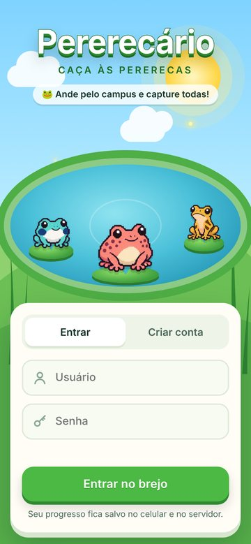
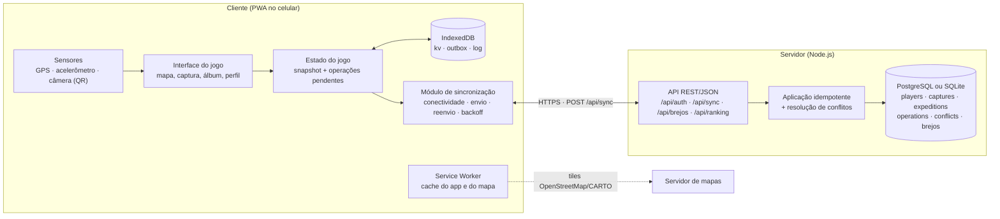
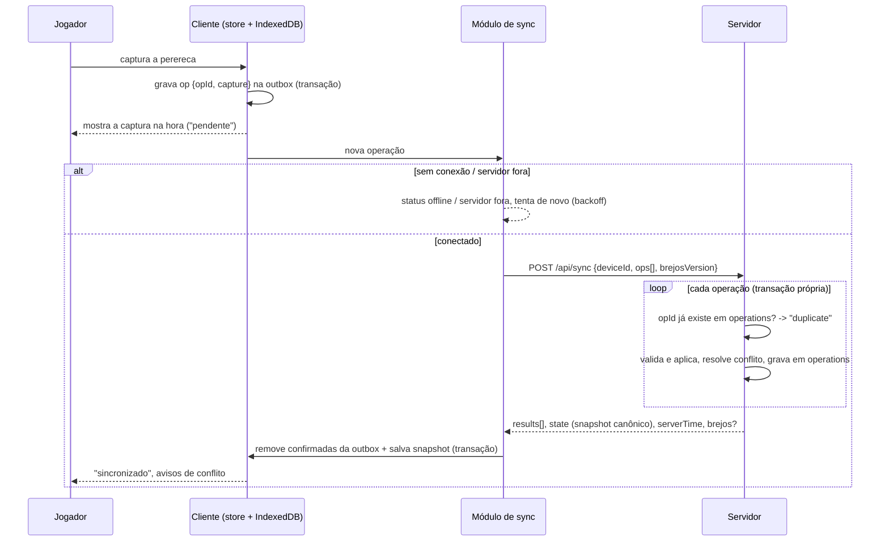
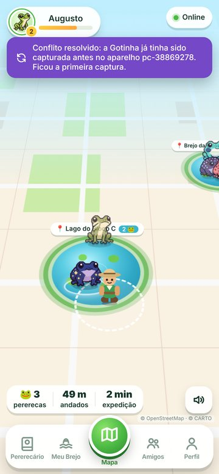
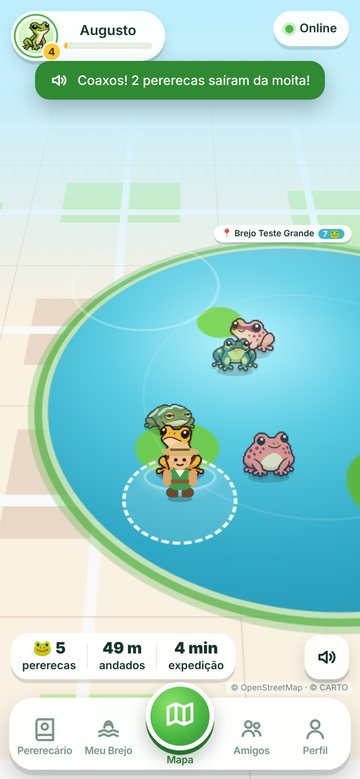

# Pererecário: documentação do trabalho

Trabalho prático de Sistemas Distribuídos: jogo para computação móvel com funcionamento online e offline.

## 1. Descrição do jogo

O Pererecário é um jogo de localização no estilo "anda e captura". Os **brejos** são lugares reais do campus (centro + raio), cadastrados no servidor e desenhados no mapa como **lagoinhas**. Em volta de cada lagoinha vivem de 3 a 7 pererecas, que mudam a cada 15 minutos. Toda perereca começa **escondida num matinho com "?"**: o jogador caminha até lá (GPS) e, a até 20 m, **chacoalha o celular** para ela sair. Depois, a até **10 m**, toca nela no mapa para escolhê-la e entra no minijogo de captura: a perereca pula entre as vitórias-régias da tela e o jogador **toca rápido** nela até encher o pote (2 a 5 toques, conforme a raridade).

Existem 15 espécies em 4 raridades (comum 55 %, incomum 28 %, rara 13 %, especial 4 %). Cada jogador escolhe o seu explorador (2 modelos × 3 tons de pele), que anda no mapa nas 4 direções. Jogadores que se encontram pessoalmente podem escanear o **QR code** um do outro: viram "parceiros de brejo" e quem escaneou ganha uma perereca-presente.

| Requisito do enunciado | No jogo |
|---|---|
| Identificação do jogador | Conta com usuário e senha; token assinado guardado no aparelho |
| Estado e progresso das partidas | **Caçada do dia** = a partida: criada automaticamente no primeiro movimento ou captura do dia; acumula capturas, XP e distância. O identificador é fixo por jogador e por dia (`dia:<jogador>:<dia>`), então dois aparelhos no mesmo dia jogam **a mesma partida** |
| Pontuações e resultados | XP por captura (10/25/60/150 + 50 por espécie nova), nível, ranking do campus |
| Histórico das partidas | No servidor, cada partida fica registrada com jogador, dia, pererecas, distância e quantos aparelhos jogaram nela (visível no painel `/admin`). No app, o **Diário de campo** mostra as últimas capturas e o Perfil mostra a caçada de hoje |

| Tela | |
|---|---|
|  |  |
|  |  |

## 2. Arquitetura

Os três componentes pedidos no enunciado:

- **Cliente** (`client/`): executa o jogo, conversa com o jogador e guarda tudo localmente (IndexedDB + Service Worker). É uma PWA: roda no navegador do celular, instala na tela inicial e abre em tela cheia.
- **Servidor** (`server/`): recebe, valida, armazena e disponibiliza os dados sincronizados. Node.js com o módulo `http` nativo; banco PostgreSQL em produção e SQLite local, com o mesmo SQL.
- **Sincronização** (`client/js/sync.js` + `server/sync.js`): fila de operações no cliente, protocolo de envio em lote, idempotência, reconciliação de estado, tratamento de falhas e de conflitos.

Uma decisão importante é que **as regras do jogo são determinísticas e compartilhadas** (`client/js/shared/game.js`, importado pelo navegador e pelo servidor). As pererecas de cada brejo são calculadas a partir de `hash(idDoBrejo | janelaDe15min)`, com um gerador pseudoaleatório. Cliente e servidor chegam exatamente às mesmas pererecas **sem trocar mensagens**. Por isso o jogo offline não depende do servidor para nada essencial, e o servidor consegue validar qualquer captura recebida depois, recalculando o encontro.

## 3. Tecnologias e protocolos

| Camada | Tecnologia |
|---|---|
| Cliente | HTML, CSS e JavaScript (módulos ES, sem etapa de build), PWA (Web App Manifest + Service Worker) |
| Armazenamento local | IndexedDB (persistente; `navigator.storage.persist()` pede ao navegador para não apagar) |
| Cache offline | Cache Storage via Service Worker |
| Mapa | Renderizador próprio em perspectiva (estilo jogo) sobre tiles raster do OpenStreetMap/CARTO |
| Sensores | Geolocation API (`watchPosition`), DeviceMotion (acelerômetro), getUserMedia + BarcodeDetector/jsQR (QR code), Vibration API, Web Audio |
| Servidor | Node.js 22, módulo `http`, `node:sqlite` (local) ou `pg` (PostgreSQL) |
| Protocolo | HTTPS com REST/JSON. Autenticação por token assinado com HMAC-SHA256 (cabeçalho `Authorization: Bearer`) |
| Senhas | scrypt com sal aleatório |
| Hospedagem | Render (web service + PostgreSQL) definido em `render.yaml` |

Rotas principais:

| Rota | Função |
|---|---|
| `POST /api/auth/register`, `POST /api/auth/login` | Cria conta / entra; devolve token, jogador e hora do servidor |
| `POST /api/sync` | Envia até 100 operações e recebe o resultado de cada uma, o estado canônico do jogador e os brejos (se mudaram) |
| `GET /api/brejos` | Lista de brejos e a versão da lista |
| `GET /api/ranking` | Ranking do campus |
| `GET /api/players/code?code=` | Busca jogador pelo código de amigo |
| `GET /api/health`, `/healthz` | Verificação de disponibilidade |
| `/api/admin/*` | Painel do servidor, cadastro de brejos e simulação de queda (exige `X-Admin-Key`) |

## 4. Estratégia de armazenamento local

O IndexedDB tem três "tabelas" (`client/js/db.js`):

- **`kv`**: sessão (token e jogador), `snapshot` (último estado confirmado pelo servidor), brejos e versão, diferença de relógio com o servidor, configurações, pererecas reveladas, distância percorrida na caçada do dia, e o identificador do aparelho (`deviceId`).
- **`outbox`**: a **fila de operações** ainda não confirmadas, em ordem (chave autoincremental). Cada operação tem `opId` (UUID gerado no aparelho), tipo, dados, horário e número de tentativas.
- **`log`**: os últimos 150 eventos de sincronização, exibidos no painel de demonstração.

**O que o jogador vê = snapshot do servidor + operações pendentes reaplicadas por cima** (`store.recompute()`). Assim:

- uma captura offline aparece na hora no Pererecário e no Meu Brejo, marcada como "pendente";
- quando o servidor confirma, a operação sai da fila e o snapshot novo já contém a captura, sem "piscar" nem duplicar;
- se o servidor decidir diferente (conflito), o snapshot canônico prevalece automaticamente.

**Atomicidade local:** a captura é gravada com uma única transação do IndexedDB que escreve a operação na fila e atualiza a atividade da caçada do dia (`db.enqueue`). Se o app fechar no meio, ou tudo foi salvo ou nada foi. Quando o servidor responde, remover as operações confirmadas e salvar o novo snapshot também acontece numa única transação (`db.outboxRemove`).

**Persistência entre aberturas:** fechar e abrir o app offline recupera o progresso: o Service Worker serve o app do cache e o IndexedDB devolve sessão, snapshot e fila. O login também fica salvo, então o jogo abre direto mesmo sem internet.

**Recursos para o modo offline:** o Service Worker guarda o "app shell" (HTML, CSS, JS, atlas das pererecas, catálogo, ícones, bibliotecas de QR). Os tiles do mapa ficam em cache conforme são vistos, e os tiles ao redor de cada brejo são baixados antecipadamente quando há conexão. As chamadas `/api/*` nunca passam pelo cache: o offline da API é tratado pelo próprio app.

## 5. Mecanismo de sincronização

**Tipos de operação:** `capture`, `favorite`, `expedition.start`, `expedition.progress`, `expedition.end`, `friend.add`, `profile.avatar`, `profile.look` (as operações `expedition.*` atualizam a caçada do dia).

**Quando sincroniza (automático, sem reiniciar a partida):**
- logo após cada nova operação;
- quando o navegador avisa que a rede voltou (evento `online`);
- quando o app volta para o primeiro plano (`visibilitychange`);
- a cada 25 s, como "batimento": é assim que chegam as capturas feitas em **outro aparelho**;
- no login, para recuperar o progresso guardado no servidor (troca de aparelho).

**Envio em lote:** até 50 operações por requisição, na ordem em que foram feitas. O servidor responde o resultado **de cada uma** (`applied`, `duplicate`, `conflict`, `rejected` ou `error`). Só saem da fila as que tiveram resposta definitiva; `error` (falha temporária) fica para a próxima tentativa.

**Idempotência ("registros duplicados não provocam alterações indevidas"):**
1. Cada operação tem um `opId` único. O servidor guarda o resultado na tabela `operations` **na mesma transação** em que aplica a operação. Se o mesmo `opId` chegar de novo, devolve o resultado guardado (`duplicate`) e não mexe em nada.
2. Além disso, cada captura tem chave única `(jogador, idDaPerereca)` e um `captureId` próprio. Nem duas operações diferentes conseguem gerar duas capturas da mesma perereca.
3. Contadores não são armazenados: XP, nível e espécies descobertas são **recalculados** a partir das capturas. Não existe incremento que possa ser aplicado duas vezes.

**Hora do jogo:** o cliente calcula a diferença entre o próprio relógio e o do servidor a cada resposta (`serverTime` comparado com o meio da requisição) e usa essa correção para decidir a janela de 15 min das pererecas. Assim cliente e servidor concordam sobre quais pererecas existem, mesmo com o relógio do celular um pouco errado.

**Coalescência:** a distância percorrida gera no máximo uma operação de progresso por minuto. Se a última operação da fila já é um progresso da mesma caçada, ela é substituída em vez de acumular (a fila não cresce enquanto o jogador anda offline).

## 6. Política de resolução de conflitos

O caso típico do enunciado: o mesmo jogador, em dois aparelhos offline, mexe na mesma partida. Como a partida é a caçada do dia, com identificador fixo, isso acontece naturalmente sempre que alguém joga em dois aparelhos no mesmo dia. A política foi escolhida **por tipo de dado**, sempre com regras **determinísticas e independentes da ordem de chegada**, para que todos os aparelhos converjam para o mesmo estado:

| Dado | Situação de conflito | Política | Por quê |
|---|---|---|---|
| **Captura** | A mesma perereca capturada nos dois aparelhos | **A primeira captura vence** (menor `caughtAt`; empate: menor `deviceId`). A outra é descartada e registrada na tabela `conflicts`. O aparelho que perdeu recebe o aviso "essa perereca já tinha sido capturada antes no aparelho X". | Uma perereca é um encontro único: contar duas vezes inflaria XP e coleção. Vencer a mais antiga é justo (quem pegou primeiro) e, por não depender da ordem de sincronização, o resultado é o mesmo se o aparelho A ou o B voltar primeiro (testado). |
| **Capturas diferentes** na mesma caçada do dia | Cada aparelho pegou pererecas diferentes | **União** (nada se perde) | Capturas distintas não competem entre si; é um conjunto que só cresce (G-Set). |
| **Distância da caçada** | Os dois aparelhos andaram | **G-Counter:** cada aparelho só aumenta a própria parcela; o servidor guarda o máximo de cada parcela e o total é a soma | Somar valores reenviados contaria duas vezes; sobrescrever perderia a distância do outro aparelho. O G-Counter resolve os dois problemas. |
| **Favorito, avatar, boneco** | Alterados nos dois aparelhos | **Last-Writer-Wins** pelo horário corrigido da alteração | Preferências simples, sem valor de jogo; vale a decisão mais recente do jogador. |
| **Amizade** | Adicionada nos dois aparelhos | Idempotente (chave única do par, mútua) | Adicionar duas vezes é o mesmo que adicionar uma. |
| **Presente do QR** | Escaneado de novo no mesmo dia / em outro aparelho | O id do encontro inclui o dia (`gift:jogador:amigo:dia`), então vale a regra da captura: só o primeiro conta | Limita a um presente por amigo por dia mesmo offline. |

Como o XP é derivado das capturas, ele converge sozinho depois que as capturas convergem.

## 7. Tratamento de falhas de comunicação

| Falha | Como o sistema reage |
|---|---|
| **Perda de conexão durante a partida** | O jogo continua igual: GPS, pererecas, captura, álbum e mapa (em cache) funcionam localmente. A pílula no topo muda para **Offline** com o número de operações pendentes. Quando a rede volta, a sincronização começa sozinha. |
| **Servidor indisponível** (rede ok, servidor fora, erro 5xx ou demora) | Status **Servidor fora** e novas tentativas com **backoff exponencial** (2 s, 4 s, 8 s… até 30 s). Nenhuma operação é descartada. Tempo limite de 8–12 s por requisição para não travar. |
| **Falha durante a sincronização** (a conexão cai depois de o servidor aplicar, antes da resposta chegar) | As operações continuam na fila porque não houve confirmação. Na próxima tentativa o servidor reconhece os `opId` e responde `duplicate` sem reaplicar. Cada operação roda numa transação no servidor: falha no meio do lote não deixa nada pela metade, e o lote inteiro pode ser reenviado com segurança. |
| **Reenvio de informações já transmitidas** | Tratado pela idempotência (seção 5): resposta `duplicate`, nenhuma alteração. O painel de demonstração tem um botão que reenvia de propósito uma operação já confirmada. |
| **Operação inválida** (perereca que não existe, horário fora da janela, longe demais) | O servidor recalcula o encontro e responde `rejected` com o motivo; a operação sai da fila e o jogador é avisado. |
| **Sessão expirada** | Resposta 401: o app avisa e pede novo login. O botão "Sair" alerta se ainda houver operações não sincronizadas. |
| **Servidor "dormindo" (Render gratuito)** | Mesmo comportamento de servidor indisponível; o jogador nem precisa perceber. |

Para a apresentação, o painel de demonstração (Perfil → Painel de demonstração) e o painel do servidor (`/admin`) permitem **simular** cada uma dessas falhas: modo avião simulado, derrubar o servidor por 60 s (o servidor responde 503 e volta sozinho), perder a resposta da próxima sincronização e reenviar uma operação confirmada. Há também o registro de eventos com cada etapa.

## 8. Computação ubíqua

O jogo muda conforme o ambiente físico do jogador:

| Recurso | Sensor / contexto | Efeito no jogo |
|---|---|---|
| **Localização geográfica** | GPS (`watchPosition`, alta precisão) | As lagoinhas são lugares reais do campus, sobre o mapa real (OpenStreetMap). Captura a até **10 m** da perereca, com até 10 m de folga automática quando o próprio GPS informa imprecisão. O boneco anda na direção do movimento. A distância caminhada entra na caçada do dia. Sinal ruim (precisão > 60 m) gera aviso, e leituras imprecisas não contam distância. |
| **Movimento: chacoalhar** | Acelerômetro (`devicemotion`) | Toda perereca começa escondida num matinho com "?". A 20 m, o matinho "espia" (aparecem olhinhos) e o jogo pede para **chacoalhar o celular**; os coaxos e a vibração fazem as pererecas saírem. |
| **Proximidade entre jogadores** | Câmera + QR code | Cada jogador tem um QR no perfil. Escanear o de outra pessoa exige estar perto dela: cria a amizade e libera uma perereca-presente. O QR carrega os dados necessários, então funciona até offline. |
| **Contexto temporal** | Relógio corrigido pelo servidor | As pererecas de cada brejo mudam a cada 15 min; os presentes são diários. |
| **Retorno físico** | Vibração e som (Web Audio) | Vibra a cada toque certeiro, ao capturar e ao chacoalhar. |

**Por que não Bluetooth:** navegadores não permitem que um celular procure outros aparelhos por perto (a Web Bluetooth só conecta a um dispositivo escolhido pelo usuário e não existe no iPhone). O QR code cumpre o mesmo papel de "prova de proximidade" e funciona em qualquer celular com câmera.

## 9. Validação e segurança no servidor

- Toda captura é revalidada: o servidor recalcula a perereca a partir do brejo e da janela de tempo e confere espécie, horário (dentro da janela + 10 min de tolerância, nunca no futuro) e distância do jogador (com tolerância de GPS). O tamanho gravado é o calculado pelo próprio servidor, não o enviado pelo aparelho.
- Presentes do QR: confere que o amigo existe, que não é o próprio jogador e que a espécie bate com o cálculo determinístico.
- Senhas com scrypt; tokens com HMAC-SHA256; limite de tentativas de login por IP; rotas de administração protegidas por chave.

## 10. Testes automatizados

`npm test` roda 12 testes (`test/sync.test.js`) com o servidor real e banco em memória:

1. cadastro, login e acesso sem token;
2. servidor e cliente calculam as mesmas pererecas;
3. reenvio da mesma operação não duplica (inclusive dentro do mesmo lote);
4. capturas inválidas são rejeitadas (espécie errada, fora do horário, longe demais);
5. **conflito entre dois aparelhos resolvido igual em qualquer ordem de chegada**;
6. favorito e boneco escolhido com last-writer-wins;
7. distância da caçada como G-Counter por aparelho;
8. QR: amizade mútua, presente único por dia, não pode adicionar a si mesmo;
9. servidor indisponível (503) e recuperação;
10. lote parcialmente aplicado reenviado inteiro com segurança;
11. ranking e progresso recuperado em outro aparelho.

Os fluxos completos (login, mapa, captura, modo offline com o app fechado e reaberto, reconexão, conflito com dois aparelhos, queda do servidor) também foram exercitados num navegador Chrome automatizado.

## 11. Limitações conhecidas

- O conjunto de brejos precisa ser cadastrado pelos organizadores (no local, pelo celular, ou pelo `/admin`).
- As artes atuais do boneco, das lagoinhas e dos matinhos são provisórias (ver `docs/ARTES.md`).
- O mapa offline mostra apenas a região já vista ou baixada antecipadamente ao redor dos brejos; fora disso aparece o gramado do jogo.
- No iPhone, o sensor de movimento só pode ser liberado após um toque do usuário (o app pede na primeira abertura).
- O relógio do aparelho é corrigido a cada sincronização; se o celular nunca ficou online depois de ter o relógio muito alterado, uma captura pode cair fora da janela e ser rejeitada.
